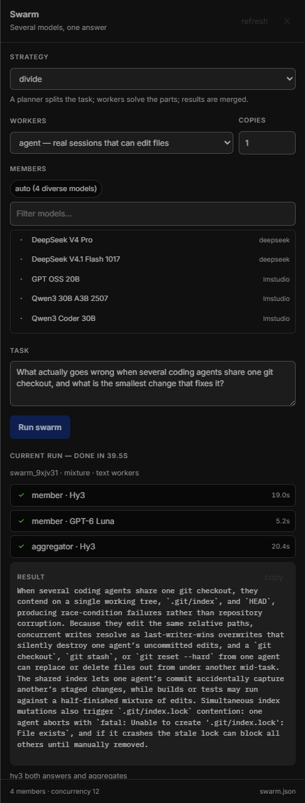

# Swarm for OpenCode

Run several OpenCode models on one task at the same time and merge what they
produce into a single answer. Five ways to combine them, a `swarm` tool and a
`/swarm` command, and an optional dashboard inside the desktop window.

It uses the models you already have enabled in OpenCode. It has no API keys of
its own.

> **Unofficial.** Not affiliated with OpenCode or its maintainers. The dashboard
> is an optional patch to the desktop app — read [Safety](#safety) before
> installing it. Nothing else in this plugin modifies OpenCode.

## Requirements

- OpenCode 2.x. Developed and tested against the desktop app **2.0.32**.
- Node 20+ to run the installer and development harnesses (the plugin itself
  runs inside OpenCode).
- The **dashboard is Windows only**, because it patches
  `%LOCALAPPDATA%\Programs\@opencodedesktop\resources\app.asar`. The strategies,
  the `swarm` tool, `/swarm` and the TUI panel work on any platform.



*The dashboard: pick a strategy, choose models, give it a task, and watch each
step — then read or copy the merged answer.*

```
        ┌─────────────┐
 task → │  members    │ → GLM-5.3 ─┐
        │ (in parallel│ → Kimi K2.7 ├→ aggregator → one answer
        │  or in turn)│ → Hy3      ─┘
        └─────────────┘
```

## What you get

| Surface | Where it shows up |
| --- | --- |
| **Dashboard** | Optional, Windows only. A **Swarm** button in the title bar beside *Home* / *New session*, and a **Swarm** row above *Settings* on the home screen: pick models and strategy, type a task, watch every step live, read and copy the merged result. |
| **`/swarm` command** | In any client's command menu. `/swarm <task>` runs a swarm; `/swarm debate <task>` forces a strategy; `/swarm status` lists recent runs. |
| **`swarm` tool** | The agent can delegate to the swarm itself, and the tool card shows live per-model progress. |
| **Timeline** | A run started from a session also mirrors its progress into that session, so you can watch it in the chat. |
| **Terminal panel** | A TUI panel with the same features, for when you use the terminal client. |

## A swarm of one model

`copies` runs each member several times, which is how you swarm a *single* model:

```json
{ "strategy": "vote", "members": ["opencode-go/gpt-6-luna"], "copies": 4 }
```

That runs four independent luna attempts and has luna judge the best — the
self-consistency pattern, which genuinely improves reliability on judgement calls.

Each copy is given a **different framing** (*first principles*, *risk-focused*,
*edge cases*, *the sceptic*, …). That is deliberate: a transient generation takes
only a prompt and a model, so there is no temperature or sampling control to vary,
and four copies of the same prompt would come back much the same. Different lenses
make the copies disagree in useful ways and give the aggregator something real to
merge. `vote` is the natural strategy for it; `debate` is the odd one out, since a
model would be critiquing its own copies.

The panel exposes this as **Copies** next to Workers, and the `swarm` tool takes a
`copies` argument.

## Choosing models

Leave `members` empty and the swarm chooses for you:

1. it starts from the model **you are already using** for the project;
2. then takes one model from **each provider**, because different providers are
   where genuinely different answers come from;
3. it **steers around models that failed recently** (15 minutes) and **favours
   models that have answered recently** (1 hour);
4. it deprioritises giveaway tiers (`-free`, `-contributor`, `-preview`), and
   never picks the same model twice from two providers.

That learning matters, because model metadata cannot tell you whether a model
will actually answer: a free tier can refuse plugin calls outright, a provider
can have a dead key, and a local provider may simply not be running. With the
memory above, an automatic roster that started with 2 usable members out of 4
reached **all members succeeding by the third run**.

You can always overrule it. Write members as `providerID/modelID`:

```json
{ "members": ["opencode-go/kimi-k2.7-code", "opencode-go/claude-opus-5-5"] }
```

A bare `modelID` is accepted too and resolved for you (`"kimi-k3"` →
`opencode-go/kimi-k3`), and so is a wrong provider prefix. Anything that cannot
be matched is reported in the run's notes rather than silently dropped.

## For agents

This is set up so an agent in a session can use a swarm without being told how:

- **A skill** at `.opencode/skills/swarm/SKILL.md`. OpenCode advertises it when a
  task looks like it deserves more than one model's opinion, and the agent loads
  it with the `skill` tool. It covers when a swarm is worth the cost, which
  strategy fits which question, and how to read a run's warnings. The field-level
  detail lives beside it in `references/configuration.md`, so it loads only when
  needed.
- **A `configure` action** on the `swarm` tool, so an agent can set the defaults
  up rather than only run once. It validates: a bad strategy or an out-of-range
  `copies` is reported back and *not* written, rather than saved as a
  configuration the plugin cannot use.

An agent can therefore be asked to "set up a swarm of luna 6 for reviews", and it
will save the roster, strategy and copies itself. Editing `.opencode/swarm.json`
by hand works too.

## Where it lives

The panel is opened from OpenCode's own interface rather than from a floating
button of its own:

- **Title bar** — a Swarm button beside *Home* and *New session*, visible in every
  view.
- **Sidebar** — a **Swarm** entry directly above *Settings* and *Help* on the home
  screen.
- Both are **clones of the real controls** (the `New session` button and the
  `Settings` row), so they inherit OpenCode's exact sizing, spacing, hover, focus
  ring and icon treatment instead of imitating it, and both show as *selected*
  while the panel is open, using the app's own active-item styling.
- The icon is OpenCode's own sprite glyph (`opencode-v2-icon-models`), not a
  custom drawing, so its weight matches the icons around it.
- If neither anchor exists — a future layout change, or a narrow window where the
  sidebar collapses — a floating **Swarm** button appears instead, so the feature
  can never become unreachable.

The drawer starts below the title bar, measured at runtime from the app's own
`-webkit-app-region` drag areas, so nothing ever sits under the window controls
(which are drawn above the page and would otherwise intercept a click).

Editing configuration is **only possible through a real user interaction**: the
panel ignores untrusted events, so a script or an automated client in the page
cannot rewrite `swarm.json`.

## Strategies

| Strategy | How the models work together | Good for |
| --- | --- | --- |
| `mixture` | Everyone answers in parallel; one model merges the results. | General questions, hard problems, "give me the best answer". |
| `debate` | Models answer, then read each other and revise, for `rounds` rounds; a merge at the end. | Contested judgement calls, design decisions, catching errors. |
| `divide` | A planner splits the task into subtasks, workers solve them in parallel, results are merged. | Big tasks that decompose cleanly. |
| `relay` | Each model improves the previous model's draft in turn. | Polishing a draft, iterative refinement. |
| `vote` | Models answer independently; a judge picks the strongest and explains why. | Decisions where you want a defensible pick. |

## Install

The plugin is two independent parts, and you can take either:

1. **The server-side plugin** — the five strategies, the `swarm` tool, `/swarm`
   and the TUI panel. No app changes, no restart.
2. **The dashboard** — optional, Windows only, and the only part that patches
   the desktop app.

### 1. The server-side plugin

Copy the `swarm` folder into your workspace's `.opencode/plugins/`, and the
skill into `.opencode/skills/`:

```sh
# from a clone of this repository
git clone https://github.com/bradl3y21/opencode-plugin-swarm.git "<workspace>/.opencode/plugins/swarm"
mkdir -p "<workspace>/.opencode/skills"
cp -r "<workspace>/.opencode/plugins/swarm/skills/swarm" "<workspace>/.opencode/skills/swarm"
```

No dependencies to install — the plugin uses the runtime OpenCode provides.

Restart OpenCode (or reload plugins). That is all: settings come from defaults
until you create `.opencode/swarm.json` — start from `swarm.example.json`.

If another plugin already registers a tool called `swarm` — for example the
unrelated npm package `opencode-swarm` — disable one of them; two tools cannot
share a name. This package is `opencode-plugin-swarm`.

### 2. The dashboard (optional, Windows)

The desktop app has no plugin UI of its own, so the dashboard is a patch to
`app.asar`. It is reversible and it verifies itself, but it is still a patch:

```sh
cd .opencode/plugins/swarm/desktop
node selftest.mjs        # proves the archive writer is lossless
node install.mjs         # backs up app.asar, then adds the panel
```

The awkward catch: you drive this plugin *from* OpenCode, so you cannot quit the
app and then ask for the install. Use the watcher — it breaks the deadlock by
waiting for the gap:

```sh
node install-when-free.mjs     # leave it running, then quit OpenCode whenever
```

It refuses to act unless no `OpenCode.exe` is running **and** the archive is
actually writable (so a slow app start cannot be patched mid-boot), runs the
self-test first, and logs every step to
`~/.local/share/opencode/log/swarm-install.log`. (The watcher is Windows-only;
elsewhere, quit the app and run `install.mjs` directly.) After it finishes, just
start OpenCode — the panel is already there. To confirm the result at any time:

```sh
node verify.mjs                # compares the patched archive to the backup
```

`install.mjs` copies `resources/app.asar` to `app.asar.swarm-backup` before its
first write, and `node install.mjs --uninstall` restores that copy byte for byte.
`node install.mjs --dry-run` shows exactly what would change without writing.

It patches by **appending**: every existing file in the archive keeps its exact
offset, size and bytes, and the panel plus the patched `index.html` are written
after the existing data. Nothing is moved or re-packed. (An earlier version
re-packed the archive and recomputed every offset; that broke an app update,
because an archive's recorded boundaries are not always a perfect tiling.) It
verifies afterwards that no existing entry moved, and `installer-test.mjs`
proves the whole thing on copies, including a deliberately malformed archive.

If you would rather not touch the app at all, or you want to iterate on the panel
without restarting OpenCode, run the harness instead — it serves the real panel
against the running server:

```sh
cd .opencode/plugins/swarm/desktop && node harness.mjs
# then open http://127.0.0.1:8799/
```

## Safety

What the dashboard patch does:

- adds one file, `/out/renderer/swarm-panel.js`, and replaces `index.html` with
  an identical copy carrying two extra `<script>` tags;
- **appends** to the archive: every existing entry keeps its offset, size and
  bytes, and the selftest proves it;
- writes `app.asar.swarm-backup` before the first write, and `--uninstall`
  restores it byte for byte;
- launches the app once after installing to prove it still starts, and restores
  the backup automatically if it does not.

What it cannot promise:

- **It is tied to the app build.** It was developed against desktop 2.0.32. An
  app update replaces `app.asar`, so the panel disappears until you reinstall;
  and if the UI changed, the panel's anchors (the *New session* button and the
  *Settings* row) may not be found. It falls back to a floating button, but a
  large redesign can still break it.
- **ASAR integrity checking.** This build has it disabled. A future build that
  enables it will refuse the patched archive; the installer's launch check
  catches that and rolls back, installing nothing.
- **It is unsupported.** This is not an OpenCode feature and is not endorsed by
  its maintainers. If the app ever fails to start, restore the archive — this
  needs the app closed, not working:

  ```sh
  node install.mjs --uninstall
  ```

  Last resort: copy `app.asar.swarm-backup` over `app.asar`.

## Use

### Dashboard

Click **Swarm** in the title bar, beside *Home* and *New session* — or the
**Swarm** row above *Settings* on the home screen.

- **Strategy** — the dropdown writes to your config straight away.
- **Members** — click models to add or remove them. With no members chosen the
  swarm picks a diverse roster automatically.
- **Workers** — `text` (plain model calls) or `agent` (real sessions that can
  read and edit your files).
- **Task** — what the swarm should work on.
- **Run swarm** — start it. The board updates as each step runs; click any step
  to read its full output. **copy** copies the merged result.

### Command

```
/swarm Rewrite this function to avoid the nested loop
/swarm debate Is a monorepo right for a 5-person team?
/swarm status
/swarm help
```

Results are posted back into the session as **synthetic messages**: they appear in
the timeline and stay in the conversation's context, but they do not force a model
turn, so a swarm costs exactly what the swarm costs. To have the agent act on an
answer, just say so — or let the agent call the `swarm` tool itself.

### Tool

Ask the agent to use it, or let it decide:

> "Get a second opinion from a few models on whether this schema is right."

The tool takes `action` (`run`, `status`, `cancel`, `models`), `task`,
`strategy`, `members`, `workerMode` and `runID`.

## Configure

Settings merge, later wins:

1. built-in defaults
2. `~/.config/opencode/swarm.json` (global)
3. `<project>/.opencode/swarm.json` (project)
4. `OPENCODE_SWARM_*` environment variables
5. plugin `options` in `opencode.json(c)`

The dashboard writes the project file, and the plugin re-reads it immediately —
**no restart needed** for any setting below except `tool` and `command`.

Copy `.opencode/swarm.example.json` to `.opencode/swarm.json` to start.

| Key | Default | Meaning |
| --- | --- | --- |
| `enabled` | `true` | Master switch. |
| `strategy` | `mixture` | `mixture`, `debate`, `divide`, `relay`, or `vote`. |
| `members` | `[]` | Models as `"providerID/modelID"` (a bare id works too). Empty = chosen automatically. |
| `aggregator` | first member | Model that merges the members' work. |
| `planner` | first member | Model that splits the task, for `divide`. |
| `judge` | first member | Model that picks the winner, for `vote`. |
| `autoMembers` | `4` | How many models automatic selection picks. |
| `workerMode` | `text` | `text` or `agent`. See the warning below. |
| `rounds` | `2` | Debate rounds, including the opening one. |
| `copies` | `1` | Run each member this many times (1–8). Above 1, a swarm of the same model. |
| `concurrency` | `4` | How many workers run at once. |
| `timeoutMs` | `180000` | Per-worker timeout for text workers. |
| `agentTimeoutMs` | `900000` | Per-worker timeout for agent workers. A full session doing real work can take many minutes. |
| `maxOutputChars` | `6000` | Truncate each answer before it reaches the aggregator. |
| `keepWorkerSessions` | `true` | Keep agent-mode worker sessions so you can inspect them. |
| `streamToSession` | `true` | Mirror run progress into the originating session. |
| `tool` | `true` | Register the agent tool. **Needs a reload.** |
| `command` | `true` | Register `/swarm`. **Needs a reload.** |
| `debugLog` | `true` | Append activity to `~/.local/share/opencode/log/swarm.log`. |

### Environment variables

`OPENCODE_SWARM_ENABLED`, `_STRATEGY`, `_MEMBERS` (comma separated),
`_AGGREGATOR`, `_PLANNER`, `_JUDGE`, `_AUTO_MEMBERS`, `_WORKER_MODE`, `_ROUNDS`,
`_CONCURRENCY`, `_TIMEOUT_MS`, `_AGENT_TIMEOUT_MS`, `_MAX_OUTPUT_CHARS`,
`_KEEP_WORKER_SESSIONS`, `_STREAM`, `_TOOL`, `_COMMAND`, `_DEBUG_LOG`.

## Agent mode

`"workerMode": "agent"` gives each model its own OpenCode session, so it can read
files, run commands and **edit your repository**. That is the point of it, and
also the risk:

- Every member works on the same checkout. Two models editing the same file will
  conflict. For anything destructive, use a worktree or keep `workerMode` on
  `text` and do the edits yourself.
- Worker sessions are named `swarm · <role> · <model>` and nested under the
  session that started the run. Set `keepWorkerSessions: false` to have them
  removed once their answer is harvested.
- Agent runs are much slower and more expensive than text runs.
- `agentTimeoutMs` (default 15 minutes) is separate from the text `timeoutMs`.
  If a worker does pass the limit, the work is not thrown away: whatever the
  session has produced is collected and the step is kept, with a warning naming
  the session so you can watch it finish.
- Planning, judging and merging always run as text calls, in either mode. They
  are pure synthesis: giving them an agent session costs minutes for no benefit.

## Cost

A `mixture` run costs one call per member plus one for the aggregator. With the
default automatic roster that is five calls. `debate` multiplies by the round
count. Turn `autoMembers` down, use cheaper models, or use `relay` for the
smallest bill.

## Files

| File | Purpose |
| --- | --- |
| `index.ts` | Server plugin: config, RPC, the `/swarm` command and the agent tool. |
| `engine.ts` | The orchestrator: roster, workers, the five strategies, run state. |
| `models.ts` | Reads OpenCode's model list and picks a diverse roster. |
| `prompts.ts` | Prompts for every role, and JSON extraction for the planner/judge. |
| `config.ts` | Config load/merge/write with live reload. |
| `settings.ts` | Tool-argument validation for saved settings (unit-testable, no runtime imports). |
| `rpc.ts` | The RPC contract shared by the dashboard and the terminal UI. |
| `tui.ts` | Terminal panel (terminal client only). |
| `log.ts` | `~/.local/share/opencode/log/swarm.log`. |
| `desktop/install.mjs` | Adds the dashboard to `app.asar`, reversibly. |
| `desktop/install-when-free.mjs` | Waits for the app to close, then installs by itself. |
| `desktop/selftest.mjs` | Proves the archive writer cannot corrupt the app. |
| `desktop/installer-test.mjs` | Runs the installer against copies, including a malformed archive, and checks nothing moved. |
| `desktop/verify.mjs` | Proves the patch changed exactly two entries and nothing else. |
| `desktop/harness.mjs` | Runs the real panel in a browser against the live server — no app changes, no restart. |
| `desktop/mirror-harness.mjs` | Proxies OpenCode's *entire* web UI into a browser (with the same patch applied), so UI integration can be developed against the real interface. |
| `desktop/swarm-panel.js` | The dashboard itself (dependency-free). |
| `skills/swarm/` | The agent-facing skill and its field reference — copy into `.opencode/skills/`. |
| `swarm.example.json` | Default settings, ready to copy to `.opencode/swarm.json`. |

## Notes and limits

- **A run never dies because a model did.** Failed members are dropped, the rest
  continue, and the final answer falls back to the best member answer if the
  aggregator itself fails. The dashboard shows each failure on its step.
- **Cancel works mid-flight.** A cancelled run stops, its in-flight steps are
  marked `cancelled` rather than quietly completing, and cancelling twice is a
  no-op.
- **Run history is in memory.** It survives the session but not a plugin reload
  or a service restart; `/swarm status` and the dashboard show what the current
  process remembers.
- **`maxOutputChars` is a real cost control.** Every member's answer is pasted
  into the aggregator's prompt, so a chatty panel is expensive to merge.
- **Timeouts cannot cancel a provider call.** A worker that times out is dropped
  from the run, but the underlying request may still finish at the provider.
- **Free-tier models can refuse plugin calls.** The `opencode/*` free tier
  answers *"free tier can only be used from within OpenCode"*. The automatic
  roster learns to avoid them; a pinned `members` list will not, so pin models
  you have actually seen work.
- **The dashboard needs no configuration.** It reads the server origin and
  credentials off the app's own API traffic, so it works whatever port the
  background service picked. It also discovers which project the swarm RPC
  answers for by probing the app's own recent sessions, so a restart that opens
  the app's home project first does not leave the panel pointing at the wrong
  place. For debugging, `window.__swarmPanel.state()` in devtools reports what it
  thinks is going on.
- **After the app updates**, re-run `install.mjs` — a new version replaces
  `app.asar`. Your `swarm.json` and this plugin are untouched by updates.

## License

MIT — see [LICENSE](LICENSE).

## Uninstall

```sh
cd .opencode/plugins/swarm/desktop && node install.mjs --uninstall   # remove the dashboard
rm -rf .opencode/plugins/swarm                                        # remove the plugin
```
